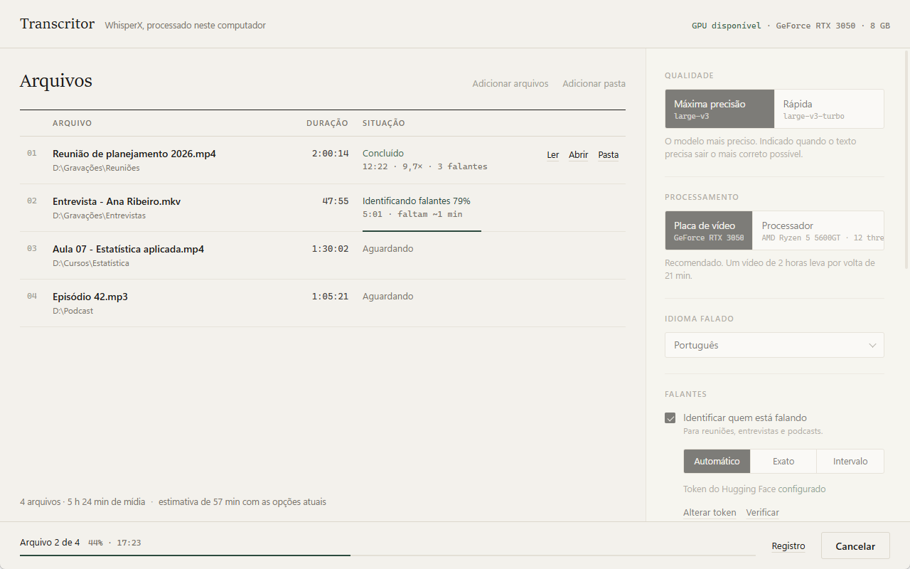
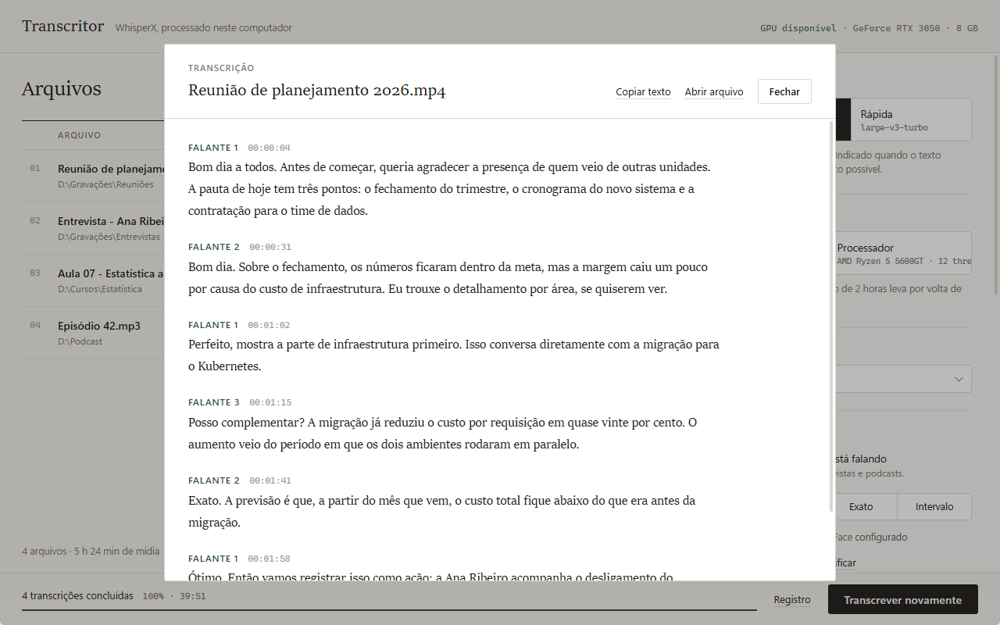
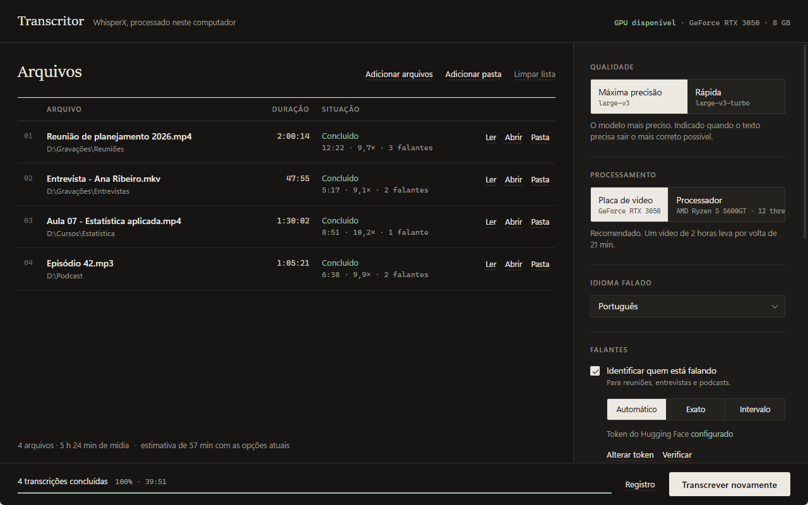

<div align="center">


# Transcritor

**Transcrição de vídeos e áudios longos, com identificação de falantes, rodando inteiramente no seu computador.**

Uma interface de mesa para Windows construída sobre o [WhisperX](https://github.com/m-bain/whisperX).<br>
Gratuito, offline e sem limite de duração.

[](https://github.com/felipekevinns/transcritor/releases/latest)
[](#requisitos)
[](https://www.python.org/)
[](LICENSE)

[Baixar](https://github.com/felipekevinns/transcritor/releases/latest) ·
[Instalação](#instalação) ·
[Como usar](#como-usar) ·
[Desempenho](#desempenho) ·
[Solução de problemas](#solução-de-problemas)

<br>



</div>

<br>

## Sobre

O Transcritor transforma horas de gravação em texto revisável em poucos minutos. Ele usa o modelo **Whisper large-v3**, o mais preciso entre os modelos abertos, acelerado pelo **faster-whisper**. O WhisperX acrescenta o alinhamento palavra por palavra e o **pyannote**, que identifica quem está falando.

Tudo acontece localmente: nenhum áudio, vídeo ou texto sai do computador. Depois que os modelos são baixados na primeira execução, o programa funciona sem internet.

Ele foi feito para quem transcreve com frequência: reuniões, entrevistas, aulas, podcasts e pesquisas qualitativas.

## Recursos

| | |
|---|---|
| **Fila de arquivos** | Arraste vídeos, áudios ou pastas inteiras. Os arquivos são processados em sequência, com progresso e tempo restante por etapa. |
| **Qualidade selecionável** | *Máxima precisão* (`large-v3`) ou *Rápida* (`large-v3-turbo`). |
| **GPU ou CPU** | Usa a placa de vídeo NVIDIA quando disponível; funciona também só com o processador. |
| **Quem falou** | Identificação de falantes com número automático, exato ou em intervalo. Os rótulos saem como *Falante 1*, *Falante 2*… |
| **Vocabulário** | Nomes, siglas e termos técnicos informados por você, para que sejam escritos corretamente. |
| **Sete formatos** | Texto corrido, texto com horários e falantes, Word (`.docx`), legendas `.srt` e `.vtt`, `.json` completo e `.tsv`. |
| **Leitura integrada** | Leia e copie a transcrição dentro do aplicativo, sem abrir outro programa. |
| **Robusto** | Reduz o lote sozinho quando falta memória na placa de vídeo e pode ser cancelado a qualquer momento. |
| **Tema claro e escuro** | Segue a configuração do Windows. |

<table>
  <tr>
    <td width="50%"></td>
    <td width="50%"></td>
  </tr>
  <tr>
    <td align="center"><sub>Leitura da transcrição, com falantes e horários</sub></td>
    <td align="center"><sub>Tema escuro, lote concluído</sub></td>
  </tr>
</table>

## Desempenho

Tempos medidos com uma **NVIDIA GeForce RTX 3050 (8 GB)** e um **AMD Ryzen 5 5600GT**, para um vídeo de **2 horas**:

| Configuração | Tempo aproximado |
|---|---|
| Placa de vídeo · Rápida | ~6 min |
| Placa de vídeo · Máxima precisão | ~10 min |
| Identificação de falantes (somar) | + ~11 min |
| Somente processador | 2 a 3 h |

Os tempos variam com a proporção de fala no áudio e com a placa de vídeo. A primeira execução também baixa os modelos (de 3 a 5 GB, uma única vez).

> **Sobre a precisão:** em áudio bem gravado, o `large-v3` costuma acertar bem mais de 95% das palavras em português. Nomes próprios raros, falas sobrepostas e música de fundo alta ainda podem gerar erros, e o campo **Vocabulário** reduz bastante os erros em termos específicos. Recomenda-se sempre uma revisão final.

## Requisitos

- **Windows 10 ou 11**, 64 bits
- **16 GB de RAM** recomendados
- **Placa NVIDIA com 6 GB ou mais** (recomendado; sem ela, o processador é usado)
- **~12 GB livres** em disco (ambiente Python e modelos)
- Conexão com a internet **apenas** na instalação e no primeiro uso

O instalador cuida do resto: Python 3.11, ffmpeg, PyTorch com CUDA, WhisperX e a interface.

## Instalação

1. Baixe o arquivo **`Transcritor-v1.0.0.zip`** na [página de versões](https://github.com/felipekevinns/transcritor/releases/latest).
2. Extraia em uma pasta definitiva, por exemplo `C:\Transcritor`. Evite caminhos dentro do OneDrive.
3. Dê dois cliques em **`Instalar.bat`** e aguarde. A instalação leva de 10 a 30 minutos, a maior parte em downloads.
4. Abra o **Transcritor** pelo atalho criado na Área de Trabalho.

O instalador pode ser executado de novo a qualquer momento para reparar a instalação: as etapas já concluídas são puladas.

<details>
<summary><b>Instalação pelo Git</b></summary>

```powershell
git clone https://github.com/felipekevinns/transcritor.git C:\Transcritor
cd C:\Transcritor
powershell -ExecutionPolicy Bypass -File .\instalar.ps1
```

Opções do instalador:

| Parâmetro | Efeito |
|---|---|
| `-CpuOnly` | Não instala o PyTorch com CUDA (computadores sem placa NVIDIA). |
| `-NoShortcut` | Não cria atalhos na Área de Trabalho. |

</details>

## Como usar

1. **Adicione os arquivos**: arraste-os para a janela ou use *Adicionar arquivos* / *Adicionar pasta*.
2. **Ajuste as opções** no painel à direita: qualidade, processamento, idioma, falantes, vocabulário e formatos.
3. Clique em **Transcrever**.
4. Ao terminar, use **Ler** para ver o texto no aplicativo, **Abrir** para abrir o documento e **Pasta** para ir até os arquivos.

Por padrão, os resultados são salvos na pasta `transcricoes`, ao lado de cada arquivo original. Também é possível escolher uma pasta única para todos.

### Identificação de falantes

Este recurso usa o modelo [`pyannote/speaker-diarization-community-1`](https://huggingface.co/pyannote/speaker-diarization-community-1). Ele é gratuito, mas exige que você aceite os termos de uso uma única vez:

1. Crie uma conta gratuita em [huggingface.co](https://huggingface.co/join).
2. Abra a [página do modelo](https://huggingface.co/pyannote/speaker-diarization-community-1), preencha *Company/university* e *Use case* e clique em **Agree and access repository**.
3. Gere um token do tipo **Read** em [Settings → Access Tokens](https://huggingface.co/settings/tokens).
4. No Transcritor, marque **Identificar quem está falando**, cole o token e clique em **Salvar**. O aplicativo confirma se o acesso foi liberado.

O token fica salvo apenas no seu computador, em `hf_token.txt`, e serve somente para baixar o modelo. Os áudios nunca são enviados.

### Formatos gerados

| Formato | Arquivo | Uso |
|---|---|---|
| Texto corrido | `nome.txt` | Texto simples, uma fala por linha |
| Texto com horários e falantes | `nome - com horários.txt` | Leitura e revisão, com blocos por falante |
| Documento do Word | `nome.docx` | Edição, impressão e envio |
| Legenda | `nome.srt` | YouTube, Premiere, DaVinci, VLC |
| Legenda para web | `nome.vtt` | Players HTML5 |
| Dados completos | `nome.json` | Cada palavra com horário, falante e confiança |
| Tabela de horários | `nome.tsv` | Planilhas e análises |

### Linha de comando

Para usar sem interface, arraste os arquivos sobre um destes arquivos:

- `transcrever.bat`: transcrição em português com `large-v3`
- `transcrever_com_falantes.bat`: o mesmo, com identificação de falantes (requer `hf_token.txt`)

## Como funciona

```
Arquivo ─► ffmpeg ─► Detecção de voz ─► Whisper large-v3 ─► Alinhamento ─► Falantes ─► Arquivos
           (16 kHz)   (pyannote/Silero)   (faster-whisper,    (wav2vec2,     (pyannote)
                                           em lotes na GPU)    por palavra)
```

1. **Áudio**: o ffmpeg extrai e normaliza o áudio de qualquer vídeo.
2. **Detecção de voz**: trechos sem fala são descartados, o que evita frases inventadas em silêncios.
3. **Transcrição**: o áudio é dividido nas pausas naturais e processado em lotes paralelos na GPU.
4. **Alinhamento**: um modelo específico para o idioma marca o início e o fim exatos de cada palavra.
5. **Falantes**: cada trecho é atribuído a uma pessoa.

A interface (`app/app.py`) roda em uma janela nativa com WebView2. A transcrição acontece em um processo separado (`app/worker.py`): isso mantém a janela responsiva, permite cancelar na hora e libera toda a memória da placa ao terminar.

## Estrutura do projeto

```
transcritor/
├── app/
│   ├── app.py                  Janela, fila e comunicação com o worker
│   ├── worker.py               Pipeline WhisperX e geração dos arquivos
│   ├── transcritor.ico
│   └── ui/                     Interface (HTML, CSS e JavaScript)
├── docs/images/                Imagens deste README
├── Instalar.bat                Instalador (duplo clique)
├── instalar.ps1                Script de instalação
├── Abrir Transcritor.bat       Abre o app mostrando erros, se houver
├── transcrever.bat             Linha de comando, sem falantes
├── transcrever_com_falantes.bat
├── requirements.txt            Versões testadas
└── CHANGELOG.md
```

## Solução de problemas

<details>
<summary><b>Erro <code>CERTIFICATE_VERIFY_FAILED</code> ao baixar modelos</b></summary>

Antivírus que inspecionam HTTPS (como o Kaspersky) substituem os certificados. O instalador inclui o `pip-system-certs`, que faz o Python usar os certificados do Windows, e a verificação continua ativa. Se o erro persistir, execute o `Instalar.bat` novamente.
</details>

<details>
<summary><b>A janela abre em branco ou acusa erro de WebView2</b></summary>

Isso costuma acontecer quando o Microsoft Edge foi removido do sistema. O Transcritor localiza automaticamente uma cópia válida do runtime. Se não houver nenhuma, o instalador instala o *Microsoft Edge WebView2 Runtime*. Para ver a mensagem completa, abra o app por `Abrir Transcritor.bat`.
</details>

<details>
<summary><b>A transcrição está muito lenta</b></summary>

Verifique se o cabeçalho do aplicativo mostra *GPU disponível* e se a opção *Placa de vídeo* está selecionada. Se a GPU não aparecer, atualize o driver da NVIDIA e execute o `Instalar.bat` novamente.
</details>

<details>
<summary><b>Memória da placa de vídeo insuficiente</b></summary>

O aplicativo reduz o lote automaticamente e tenta de novo. Em placas com menos de 6 GB, escolha o lote 4 em *Avançado* ou a qualidade *Rápida*.
</details>

<details>
<summary><b>Acesso negado ao modelo de falantes</b></summary>

O token é válido, mas os termos do modelo não foram aceitos na mesma conta. Repita o passo 2 de [Identificação de falantes](#identificação-de-falantes) e use **Verificar** no aplicativo.
</details>

Detalhes técnicos de cada execução ficam em **Registro**, na barra inferior, e em `app/ultimo_registro.txt`.

## Créditos

O Transcritor é uma interface sobre excelentes projetos de código aberto:

- [WhisperX](https://github.com/m-bain/whisperX): transcrição em lote, alinhamento e falantes (BSD-2-Clause)
- [Whisper](https://github.com/openai/whisper), da OpenAI: modelos de reconhecimento de fala (MIT)
- [faster-whisper](https://github.com/SYSTRAN/faster-whisper): inferência otimizada com CTranslate2 (MIT)
- [pyannote.audio](https://github.com/pyannote/pyannote-audio): detecção de voz e identificação de falantes (MIT; o modelo *community-1* é CC-BY-4.0)
- [pywebview](https://github.com/r0x0r/pywebview): janela nativa (BSD-3-Clause)
- [FFmpeg](https://ffmpeg.org/): leitura de áudio e vídeo

## Licença

Distribuído sob a licença MIT. Veja [`LICENSE`](LICENSE).
